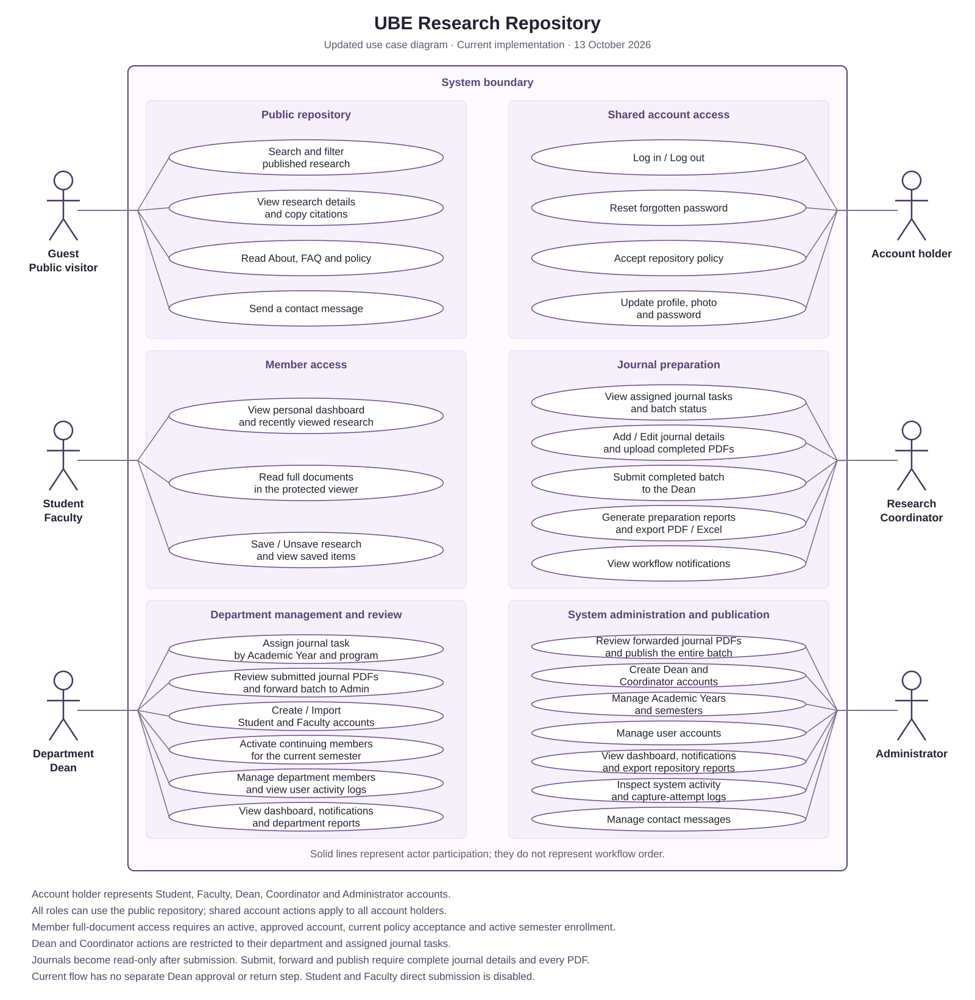

# UBE Research Repository — Updated Use Case Diagram

Updated 13 October 2026 from the current working tree, including uncommitted changes.

[Open SVG](use-case-diagram.svg) · [Editable PlantUML source](use-case-diagram.puml)

This is a goal-level diagram of the active public, member and staff workflows. Student and Faculty share member use cases; the Faculty account uses the internal `researcher` role. Account holder is a shared actor representing all signed-in roles. PlantUML actor generalization shows inheritance of public and account capabilities; the SVG presents these shared capabilities separately for readability.

## Current journal workflow

Dean assigns an Academic Year/program journal task → Coordinator saves journal details and uploads finished PDFs → Coordinator submits the completed batch → Dean reviews and forwards it to Admin → Admin publishes every journal in the batch together as separate repository entries.

There is no separate Dean approval, return or revision action in the current batch workflow. Submitted journals cannot be edited. Submission, forwarding and publication each require a nonempty batch with complete details and an existing PDF for every journal. Dean and Coordinator access is restricted by department and assignment ownership.

Member full-document access requires an active, approved account and active semester enrollment, with the current repository policy accepted. Students and Faculty cannot submit research directly. No public self-registration route is exposed; Deans create/import member accounts and Administrators create Dean/Coordinator accounts.

## Scope and source checks

The diagram summarizes active goals rather than every endpoint. Existing historical submission listings and legacy single-journal compatibility paths are omitted. Legacy controller methods without a current route are not treated as active features. Batch journals are not shown with individual archive/delete actions because those endpoints reject batch members.

- [Routes](../routes/web.php): public, authenticated and staff entry points.
- [User role and access checks](../app/Models/User.php): staff distinctions, full-document eligibility and disabled direct submission.
- [Research controller](../app/Http/Controllers/ResearchController.php): repository browsing, viewer, saved items and member dashboard.
- [Admin controller](../app/Http/Controllers/AdminController.php): assignments, member imports, academic periods, accounts and reports.
- [Journal batch controller](../app/Http/Controllers/JournalBatchController.php) and [workflow service](../app/Services/JournalBatchWorkflow.php): ownership, preparation and transitions.
- [Activity log controller](../app/Http/Controllers/UserActivityLogController.php): Dean member logs and Administrator system logs.
- [Policy middleware](../app/Http/Middleware/EnsureRepositoryPolicyAccepted.php): current policy acceptance.
- [Journal workflow notes](journal-workflow.md): current batch lifecycle and report scope.

Regenerate SVG and PlantUML after editing the goal definitions with `node docs/generate-use-case-diagram.mjs`.
